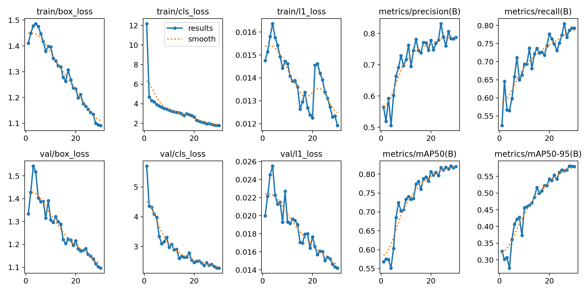
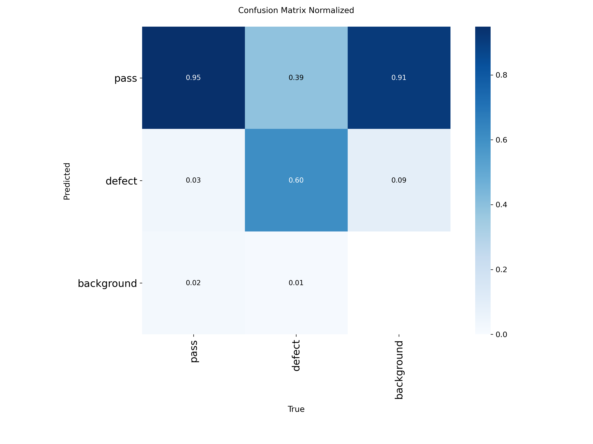
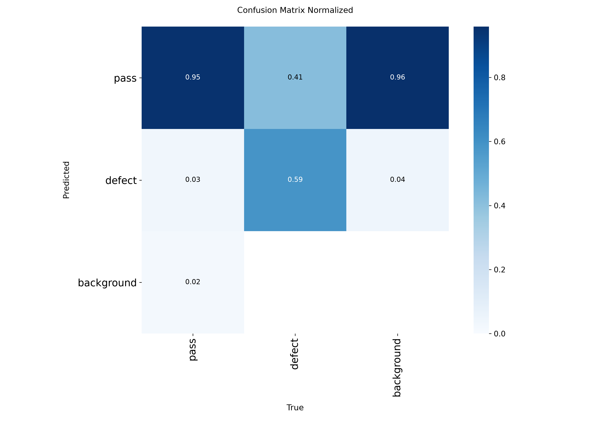
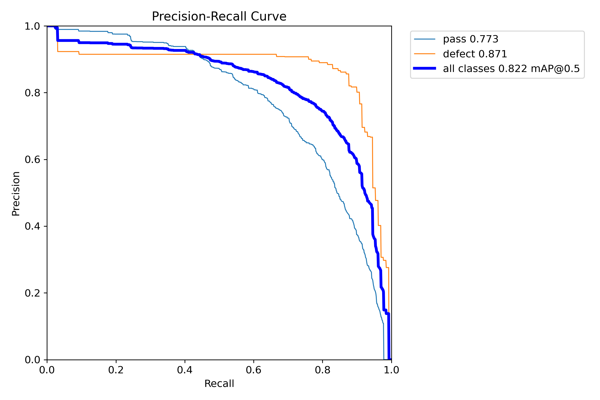
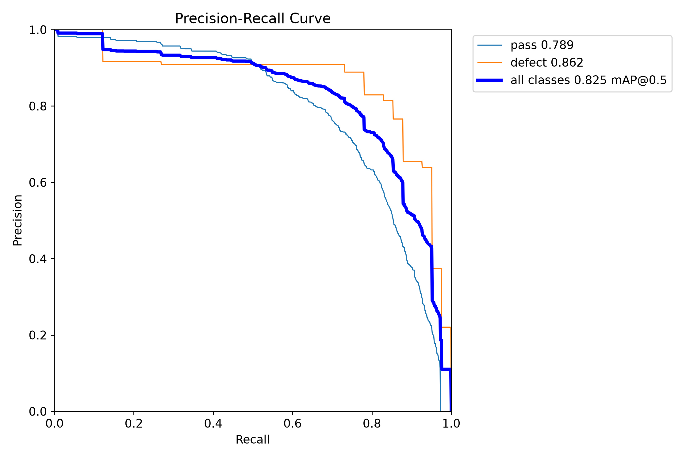

# ConveyorVision — YOLO26 30-Epoch Training & Evaluation Report

Báo cáo kết quả huấn luyện và đánh giá thực nghiệm mô hình thị giác máy tính **YOLO26 Nano** cho bài toán phân loại sản phẩm đạt chuẩn (`pass`) / phế phẩm (`defect`) trên băng chuyền công nghiệp.

---

## 1. Thông Số Huấn Luyện (Training Setup)

| Thông số | Giá trị |
| :--- | :--- |
| **Kiến trúc mô hình** | **YOLO26 Nano** (`yolo26n.pt` native, End-to-end NMS-free) |
| **Số layer / Tham số** | 260 layers, 2,504,580 parameters, 5.9 GFLOPs |
| **Kích thước file trọng số** | **5.45 MB** (phù hợp triển khai biên Edge/IoT/Embedded) |
| **Môi trường huấn luyện** | Google Colab GPU Runtime (NVIDIA L4/T4) |
| **Thời gian huấn luyện** | **463.2 giây (~7.7 phút)** cho 30 epochs (~15.4 giây/epoch) |
| **Quy mô tập dữ liệu** | 2.666 ảnh (Train: 1.692, Val: 533, Test: 441) |
| **Batch size / Image size** | 16 / 640x640 |
| **Optimizer** | AdamW (`lr=0.001667`, `momentum=0.9`) |
| **Trọng số phân loại (`cls`)** | `cls=1.2` (hỗ trợ bù trừ mất cân bằng lớp 10:1) |

---

## 2. Kết Quả Huấn Luyện Trên Tập Validation (533 ảnh)

Tiến trình đo lường qua các mốc epoch trên tập Validation:

| Chỉ số | Epoch 1 | Epoch 10 | Epoch 20 | Epoch 30 (Final) |
| :--- | :---: | :---: | :---: | :---: |
| **Precision (Độ chính xác)** | 56.5% | 71.6% | 77.8% | **78.7%** |
| **Recall (Độ nhạy / Bắt trúng)** | 52.3% | 69.3% | 77.7% | **79.3%** |
| **mAP@50** | 56.8% | 73.3% | 80.6% | **82.0%** |
| **mAP@50-95** | 32.6% | 45.6% | 54.2% | **58.0%** |
| **Box Loss (Train / Val)** | 1.410 / 1.333 | 1.396 / 1.307 | 1.234 / 1.216 | **1.091 / 1.097** |
| **Class Loss (Train / Val)** | 12.19 / 5.704 | 3.344 / 2.972 | 2.644 / 2.459 | **1.775 / 2.276** |

---

## 3. Kết Quả Đánh Giá Độc Lập Trên Tập Test (441 ảnh, 1.032 Bounding Boxes)

Đánh giá bằng lệnh `python src/conveyorvision/evaluate.py --split test --model models/conveyor_yolo26_30ep_best.pt` trên 441 ảnh phân tập test:

| Lớp (Class) | Số lượng ảnh | Số Bounding Box | Precision | Recall | mAP@50 | mAP@50-95 |
| :--- | :---: | :---: | :---: | :---: | :---: | :---: |
| **Tất cả (Overall)** | **441** | **1.032** | **78.2%** | **75.7%** | **82.5%** | **61.4%** |
| `pass` (Đạt chuẩn) | 381 | 991 | 79.7% | 66.1% | 78.9% | 51.2% |
| `defect` (Lỗi / Phế phẩm) | 36 | 41 | **76.6%** | **85.4%** | **86.2%** | **71.7%** |

> [!NOTE]
> **Quan sát trên lớp phế phẩm (`defect`):** Mô hình đạt độ nhạy **Recall = 85.4%** và **mAP@50 = 86.2%**. Trọng số phân loại thực nghiệm `cls=1.2` bước đầu cho thấy định hướng tốt trong việc tăng phạt lỗi bỏ sót phế phẩm (False Negative) khi dữ liệu lệch lớp (~10:1). Để khẳng định một cách chặt chẽ về mặt khoa học, thí nghiệm triệt tiêu (ablation study) đối chứng trực tiếp với `cls=0.5` mặc định cần được thực hiện trong giai đoạn tiếp theo.

> [!WARNING]
> **Lưu ý phương pháp luận — Rủi ro rò rỉ dữ liệu cận trùng (Near-Duplicate Leakage):**
> Qua kiểm tra đối sánh hàm băm tri giác (perceptual similarity), ghi nhận **53 cặp ảnh cận trùng** giữa tập Train và tập Test (41 ảnh test có bản sao rất gần trong train, trong đó có **23/36 ảnh test chứa defect**). Nguyên nhân do dữ liệu trích xuất từ chuỗi khung hình video hoặc các phiên bản Roboflow được chia ngẫu nhiên theo ảnh thay vì theo phiên quay (session).
> 
> Vì vậy, các chỉ số trên tập Test hiện tại nên được hiểu là **ngưỡng trên thực nghiệm (empirical upper bound)**. Để kiểm định khả năng tổng quát hóa thực sự, khuyến nghị phân tách tập test hoàn toàn theo từng video clip / lô sản xuất độc lập (video/session-based split).

---

## 4. Đo Lường Thực Nghiệm Hiệu Năng & Tốc Độ (Inference Benchmark)

* **Đo lường thực tế trên CPU (Empirical Measurement):**
  - Cấu hình: Intel Core i7-8565U CPU @ 1.80GHz (laptop văn phòng phổ thông, không có GPU rời).
  - Tiền xử lý (Preprocess): **3.1 ms/ảnh**
  - Suy luận mô hình (Inference): **125.9 ms/ảnh**
  - Hậu xử lý (Postprocess): **2.4 ms/ảnh**
  - **Tốc độ thực tế đạt được:** **~7.9 FPS** (phù hợp với các hệ thống kiểm tra tĩnh theo chu kỳ hoặc trạm dừng băng chuyền chậm).
* **Tốc độ ước tính trên GPU công nghiệp (Projected Edge GPU):**
  - Dự kiến **>80 FPS** khi chạy trên NVIDIA Tesla T4 / RTX 3060 / Jetson Orin Nano (khi export sang TensorRT/FP16).
  - Tốc độ thực tế trong môi trường sản xuất sẽ phụ thuộc thêm vào độ trễ nạp khung hình camera công nghiệp (GenICam/USB3) và thuật toán tracking ByteTrack.

---

## 5. Biểu Đồ Trực Quan Hóa (Visual Analytics)

### 5.1. Tiến trình huấn luyện (Loss & Performance Curves)

### 5.2. Ma trận nhầm lẫn (Confusion Matrix)
| Tập Validation (533 ảnh) | Tập Test Độc Lập (441 ảnh) |
| :---: | :---: |
|  |  |

### 5.3. Đường cong Precision - Recall (PR Curve)
| Tập Validation | Tập Test Độc Lập |
| :---: | :---: |
|  |  |

---

## 6. Thảo Luận Kỹ Thuật & Giới Hạn Thực Tế (Discussion & Limitations)

### 6.1. Vấn đề khoảng cách miền (Domain Gap / Covariate Shift)
Trong bài toán thị giác công nghiệp, hiện tượng **"học tốt trên tập dữ liệu lab nhưng giảm hiệu quả khi ra môi trường nhà máy thật"** là thách thức phổ biến do:
1. **Chiếu sáng & Phản quang:** Bề mặt chai nhựa/thủy tinh phản chiếu ánh đèn nhà xưởng khác với studio chụp mẫu.
2. **Chuyển động & Nhòe hình (Motion Blur):** Vận tốc băng chuyền thực tế có thể tạo vệt mờ chuyển động nếu màn trập camera (shutter speed) chưa đồng bộ.
3. **Biến thể sản phẩm mới:** Màu sắc nắp, nhãn mác, hình dáng chai khác biệt so với 2.666 ảnh huấn luyện ban đầu.

### 6.2. Giải pháp kỹ thuật đã triển khai & Khuyến nghị tiếp theo
* **Cơ chế Multi-frame Voting:** Đã được tích hợp trực tiếp vào `src/conveyorvision/inference_conveyor.py`. Thay vì phán quyết ngay ở frame đầu tiên (dễ nhầm do góc nghiêng hoặc mép ảnh), hệ thống tích lũy lịch sử nhận diện của từng Track ID qua ByteTrack. Chai chỉ được kết luận `DEFECT` khi có $\ge 2$ frame phát hiện lỗi hoặc 1 frame lỗi có độ tự tin cao ($\ge \max(0.5, \text{conf\_thresh})$).
* **Kế hoạch kiểm định hiện trường:**
  1. Thu thập 100–200 ảnh hoặc video clip trực tiếp tại vị trí lắp đặt camera thực tế.
  2. Thực hiện Fine-tuning (Domain Adaptation) 5–10 epochs trên ảnh hiện trường trước khi vận hành tự động cơ cấu gạt/đẩy phế phẩm.
  3. Đo đạc benchmark FPS trực tiếp trên phần cứng nhúng biên công nghiệp (Edge AI box).
