# BÁO CÁO TIẾN ĐỘ ĐỒ ÁN CONVEYORVISION

**Ngày rà soát:** 12/10/2026  
**Thư mục dự án:** `D:\ConveyorVision`  
**Căn cứ:** nội dung repo hiện có và đề xuất YOLO26 cập nhật ngày 11/10/2026. Đây là báo cáo hiện trạng; các mục tiêu trong proposal được dùng làm mốc tham chiếu, không được xem là kết quả đã hoàn thành.

## 1. Tóm tắt tiến độ

ConveyorVision đang ở **giai đoạn chuẩn bị dữ liệu và chốt phạm vi bài toán**. Repo đã có skeleton, cấu hình môi trường, script lấy frame từ video và một bộ dữ liệu Roboflow gồm 1.740 ảnh. Tuy vậy, dữ liệu hiện tại chưa khớp với mục tiêu `pass/defect` trong đề xuất; cấu hình dữ liệu còn mâu thuẫn; chưa thấy kết quả huấn luyện, mô hình đã fine-tune hay ứng dụng demo.

| Hạng mục | Hiện trạng | Nhận xét |
|---|---|---|
| Khung repo và tài liệu | Đã có | Có README, requirements, ba PDF đề xuất và thư mục skeleton. |
| Trích frame | Có mã nguồn | `src/conveyorvision/video_io.py` đọc video và lưu frame/manifest; chưa thấy video đầu vào hoặc manifest được tạo trong repo. |
| Dataset | Đã có dữ liệu cục bộ | 1.044 train, 348 valid, 348 test; nhãn hiện chỉ có class `bottle`. |
| Định nghĩa nhãn đồ án | Chưa khớp | Proposal YOLO26 dùng `pass` và `defect`; cần chốt lại mục tiêu hoặc gán nhãn lại. |
| Cấu hình dataset | Cần sửa trước khi train | Có hai file `data.yaml` khác nhau về đường dẫn và class. |
| Huấn luyện/đánh giá | Chưa có bằng chứng đã chạy | Chưa thấy `best.pt`, thư mục `runs/`, log hay bảng metric. |
| Tracking, API và giao diện | Chưa triển khai | `app/` chỉ có `.gitkeep`; chưa có worker, endpoint hay giao diện. |
| Kiểm thử và báo cáo kết quả | Chưa triển khai | `tests/`, `notebooks/`, `reports/` trước báo cáo này chỉ có `.gitkeep`. |

Chưa thể báo cáo mAP, Recall, Precision, FPS/latency hoặc sai số đếm: repo chưa có kết quả thực nghiệm. Không nên ghi số liệu giả định thành kết quả đồ án.

## 2. Rà soát dữ liệu

Kiểm tra cấu trúc nhãn YOLO cho thấy tên ảnh và nhãn khớp nhau ở cả ba split; không phát hiện nhãn thiếu, nhãn dư, dòng sai định dạng hay tọa độ hộp ngoài khoảng chuẩn hóa. Đây mới là kiểm tra cấu trúc, **không phải đánh giá bằng mắt về độ đúng của bounding box**.

| Split | Ảnh | File nhãn | Box | Nhãn rỗng | Class trong nhãn |
|---|---:|---:|---:|---:|---|
| Train | 1.044 | 1.044 | 2.605 | 46 | chỉ class `0` |
| Validation (`valid`) | 348 | 348 | 918 | 12 | chỉ class `0` |
| Test | 348 | 348 | 902 | 11 | chỉ class `0` |
| **Tổng** | **1.740** | **1.740** | **4.425** | **69** | **chỉ class `0`** |

Metadata Roboflow và `data.yaml` ở repo root đặt tên class `bottle`. Trong khi đó, proposal mới mô tả phát hiện trạng thái sản phẩm với hai class `pass`/`defect`. Vì vậy, bộ dữ liệu hiện tại chưa thể dùng để đánh giá khả năng phân biệt sản phẩm đạt và lỗi. 69 nhãn rỗng cần được xác nhận là ảnh nền/không có sản phẩm theo quy ước dataset, không mặc định xem đó là nhãn lỗi.

Repo hiện không có `raw_videos/` hoặc `manifest.csv`. Chưa có bằng chứng cho thấy các split được tách theo video/lô; không thể kết luận đã tránh rò rỉ giữa các frame gần nhau. Điều này cũng có nghĩa là chưa thể đánh giá tracking và đếm sản phẩm xuyên video bằng bộ hiện tại.

## 3. Tiến độ so với kế hoạch 6 tuần

| Mốc proposal | Trạng thái khi rà soát | Việc còn thiếu để đóng mốc |
|---|---|---|
| Tuần 1 — chốt bài toán, nhãn, kiến trúc, môi trường | **Một phần** | Chọn chính thức bài toán `bottle` hay `pass/defect`; viết data card và quy tắc gán nhãn. |
| Tuần 2 — thu thập, lấy mẫu, gán nhãn, audit | **Một phần** | Xác minh nguồn/phạm vi dữ liệu; bổ sung video đại diện nếu cần tracking; audit bằng mắt và kiểm tra lớp. |
| Tuần 3 — chia tập theo video/lô, kiểm tra leakage, hoàn tất YAML | **Chưa đạt** | Xác nhận nguồn từng ảnh; chia theo nhóm video/lô; thống nhất một YAML trỏ đúng thư mục và class. |
| Tuần 4 — YOLO26n/YOLO26s và đánh giá validation | **Chưa bắt đầu** | Chạy baseline sau khi dữ liệu và YAML đạt điều kiện. |
| Tuần 5 — FastAPI, worker, tracking và giao diện demo | **Chưa bắt đầu** | Xây sau khi có model inference ổn định và schema kết quả. |
| Tuần 6 — kiểm thử end-to-end, latency, báo cáo và slide | **Chưa bắt đầu** | Cần có ứng dụng, bộ video demo, số liệu test và phân tích lỗi thực tế. |

Đánh giá chung: đã có phần khung dự án và dữ liệu ban đầu, nhưng **chưa qua cổng sẵn sàng huấn luyện**. Không quy đổi thành phần trăm tiến độ vì chưa có trọng số công việc hoặc lịch thực hiện thực tế trong repo.

## 4. Sơ đồ cấu trúc repo tại thời điểm rà soát

```text
D:\ConveyorVision\
├── .venv/                         # môi trường cục bộ, bị Git bỏ qua
├── app/
│   └── .gitkeep                   # chưa có API/worker/UI
├── data/
│   ├── data.yaml                  # cấu hình skeleton 2 class, path mẫu
│   ├── images/{train,val}/        # hiện chỉ có .gitkeep
│   └── labels/{train,val}/        # hiện chỉ có .gitkeep
├── doc/
│   ├── ConveyorVision_Project_Proposal.pdf
│   ├── ConveyorVision_Project_Proposal_YOLO26.pdf
│   └── ConveyorVision — Đề xuất dự án (nâng cấp sang YOLO26).pdf
├── models/
│   └── .gitkeep                   # chưa có checkpoint trong checkout này
├── notebooks/
│   └── .gitkeep                   # chưa có notebook
├── reports/
│   ├── .gitkeep
│   └── Bao_cao_tien_do_ConveyorVision_2026-10-12.md
├── src/conveyorvision/
│   ├── __init__.py
│   └── video_io.py                # trích frame và ghi manifest
├── tests/
│   └── .gitkeep                   # chưa có mã kiểm thử
├── train/{images,labels}/         # 1.044 cặp, dữ liệu cục bộ chưa track
├── valid/{images,labels}/         # 348 cặp, dữ liệu cục bộ chưa track
├── test/{images,labels}/          # 348 cặp, dữ liệu cục bộ chưa track
├── data.yaml                      # 1 class bottle; đường dẫn cần chỉnh
├── README.md
├── README.dataset.txt             # cục bộ, chưa track
├── README.roboflow.txt            # cục bộ, chưa track
└── requirements.txt
```

Ảnh chụp VS Code có `yolo26n.pt` ở thư mục gốc; trong checkout được rà soát hiện tại không tìm thấy checkpoint đó, còn `models/` chỉ có `.gitkeep`. Cần đồng bộ/kiểm tra đúng môi trường trước khi chạy train. Các thư mục `train/`, `valid/`, `test/` và một số README/config đang hiện diện ở máy nhưng chưa được Git theo dõi; không nên đưa dữ liệu/video lớn hoặc có hạn chế quyền sử dụng lên repo nếu chưa thống nhất cách lưu trữ.

## 5. Các điểm cần xử lý trước khi huấn luyện

1. **Chốt class và phạm vi MVP.** Chọn một trong hai hướng: (a) phát hiện sản phẩm và phân loại `pass`/`defect`, khi đó cần nhãn đủ hai lớp theo đúng định nghĩa; hoặc (b) chỉ phát hiện `bottle`, khi đó phải sửa mục tiêu và tiêu chí nghiệm thu của đồ án. Không dùng class `bottle` để tuyên bố đã phân loại chất lượng sản phẩm.
2. **Chọn một cấu hình dataset chuẩn.** `data/data.yaml` đang là mẫu cho hai class với đường dẫn placeholder và `images/train`, `images/val`; `data.yaml` ở root khai báo một class `bottle`, trỏ `../train/images`, `../valid/images`, `../test/images`. Cấu hình root cần được kiểm tra vì `../` đi lên một cấp khỏi repo; cấu hình `data/data.yaml` cũng không khớp bố cục dataset hiện tại.
3. **Xác nhận provenance và split.** Lưu nguồn dữ liệu/phiên bản, video hoặc lô gốc nếu có, quy tắc lấy mẫu và manifest. Nếu dữ liệu chỉ là ảnh rời không có ID nguồn, ghi rõ giới hạn và không khẳng định split theo video/lô.
4. **Chốt định dạng lưu dữ liệu và Git.** Dữ liệu đang nằm ngoài các thư mục `data/images`/`data/labels` mà README mô tả, và hiện chưa được track. Cần thống nhất nơi lưu dataset, cách tái tạo dataset, version và quy tắc ignore trước khi tiếp tục.
5. **Xác nhận checkpoint và môi trường chạy.** Lưu lại phiên bản Python/thư viện, thiết bị train, checkpoint pretrained được dùng và cấu hình thí nghiệm; không nhầm checkpoint pretrained với `best.pt` đã fine-tune.

## 6. Quy trình tiếp theo đề xuất

```mermaid
flowchart LR
  A[Chốt bài toán và class] --> B[Xác minh nguồn dữ liệu]
  B --> C[Chuẩn hóa nhãn và audit]
  C --> D[Chia train/val/test theo video hoặc lô]
  D --> E[Khóa data.yaml và cấu hình]
  E --> F[Train baseline YOLO26n]
  F --> G[Đánh giá và chọn ngưỡng trên val]
  G --> H[Khóa model rồi đánh giá test một lần]
  H --> I[Đánh giá tracking và sai số đếm]
  I --> J[FastAPI + worker + giao diện]
  J --> K[Demo end-to-end và hoàn thiện báo cáo]
```



| Bước | Công việc | Đầu ra/điều kiện hoàn tất |
|---:|---|---|
| 0 | Chốt bài toán, định nghĩa `pass`/`defect` (hoặc `bottle`), đối tượng được đếm và tiêu chí demo với giảng viên/nhóm. | Data card và checklist gán nhãn; class ID cố định; tiêu chí nghiệm thu rõ ràng. |
| 1 | Xác minh nguồn, giấy phép và đại diện dữ liệu. Thu thập video dây chuyền nếu mục tiêu gồm tracking; giữ video gốc theo quyền truy cập và tạo manifest `video_id`, `frame_idx`, `timestamp`, `image_path`. | Dataset có provenance; có video/lô độc lập cho các split hoặc ghi rõ giới hạn nếu không có. |
| 2 | Chuẩn hóa/gán nhãn bounding box theo class đã chốt; kiểm tra ảnh nền và các nhãn rỗng; review một phần nhãn bằng mắt. | Nhãn YOLO đúng class, khớp ảnh; checklist và thống kê class/box được ghi lại. |
| 3 | Tạo lại hoặc xác nhận train/validation/test theo video/lô, rà ảnh trùng và frame gần nhau; chọn một vị trí YAML và một cấu trúc folder chính thức. | Split không trộn nguồn giữa các tập; YAML trỏ đúng thư mục và khai báo đúng class; báo cáo audit dữ liệu. |
| 4 | Khóa môi trường và cấu hình; kiểm tra khả năng đọc dataset; chạy pilot ngắn với YOLO26n để xác nhận pipeline. | Ghi phiên bản thư viện, seed, imgsz, batch, thiết bị; có log pilot và không có lỗi schema/path. |
| 5 | Huấn luyện YOLO26n làm baseline; sau đó chạy YOLO26s trên cùng split và thiết lập nếu tài nguyên cho phép. Lưu riêng từng lần chạy. | `best.pt`/checkpoint, cấu hình và log; so sánh công bằng, không dùng test để chọn model. |
| 6 | Trên validation, lập PR/threshold sweep; báo cáo mAP50, mAP50-95, Precision/Recall `defect`, FN/FP, confusion matrix cấp object và latency. | Chọn và ghi confidence threshold theo yêu cầu Recall/chi phí bỏ sót; khóa model + ngưỡng trước khi test. |
| 7 | Chạy test độc lập một lần sau khi đã khóa lựa chọn; phân tích false positive/false negative và ví dụ lỗi. | Bảng kết quả test trung thực, kèm giới hạn và điều kiện dữ liệu. |
| 8 | Với video chưa dùng để chọn model/ngưỡng, nối tracker (ví dụ ByteTrack), audit track ID và so sánh số đếm với đếm tay. | Video overlay; sai số đếm và trường hợp mất/tách ID được ghi nhận. |
| 9 | Xây lớp inference trước, sau đó FastAPI upload/status/result/health/export, worker xử lý video và giao diện xem overlay/tổng hợp. Thêm giới hạn file và xử lý lỗi đầu vào. | Demo upload → xử lý → kết quả; trả được bbox/class/confidence/track ID; xuất CSV/JSON. |
| 10 | Rà luồng hợp lệ/không hợp lệ, đo latency trên thiết bị đã ghi, hoàn thiện README, model card, báo cáo và slide. | Tái chạy được từ hướng dẫn; báo cáo có số liệu thật, ảnh lỗi và giới hạn; demo cuối. |

### Việc nên làm ngay

1. Chốt bộ dữ liệu sẽ phục vụ class `bottle` hay `pass/defect`.
2. Chọn và sửa một `data.yaml`, đồng thời thống nhất nơi lưu dataset.
3. Xác minh nguồn video/ảnh và khả năng tách split theo video/lô.
4. Chỉ bắt đầu huấn luyện sau khi ba việc trên được xác nhận; ưu tiên YOLO26n làm pilot.

## 7. Sơ đồ luồng xử lý mục tiêu

```text
Video đầu vào
  -> kiểm tra file và metadata
  -> lấy frame + manifest
  -> YOLO26 phát hiện sản phẩm và trạng thái
  -> tracking qua các frame
  -> tổng hợp theo track ID, tránh đếm lặp
  -> API/job trả trạng thái và kết quả
  -> video overlay + bảng thống kê + CSV/JSON
```

## 8. Tài liệu đã đối chiếu

- [Đề xuất dự án YOLO26 — bản 14 trang](../doc/ConveyorVision_Project_Proposal_YOLO26.pdf): phạm vi `pass`/`defect`, pipeline detect + track, kế hoạch sáu tuần, tiêu chí đánh giá và đầu ra.
- [README.md](../README.md): hướng dẫn repo hiện tại; một số đường dẫn/cấu trúc vẫn theo skeleton ban đầu và cần đồng bộ với dataset thực tế.
- [data.yaml](../data.yaml) và [data/data.yaml](../data/data.yaml): hai cấu hình dataset đang cùng tồn tại nhưng không thống nhất.
- [video_io.py](../src/conveyorvision/video_io.py): script trích frame và ghi manifest.
- [README.dataset.txt](../README.dataset.txt) và [README.roboflow.txt](../README.roboflow.txt): metadata dataset Roboflow cục bộ, hiện chưa được Git theo dõi.

**Kết luận:** ưu tiên xử lý đúng class, nguồn dữ liệu/split và cấu hình YAML. Khi đã qua cổng dữ liệu, tiếp tục theo thứ tự baseline → validation/threshold → test độc lập → tracking/counting → web demo → báo cáo nghiệm thu. Hiện tại chưa có căn cứ để kết luận mô hình đã đạt chất lượng hay ứng dụng đã hoàn thành.
